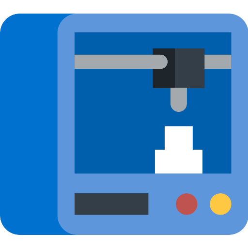

<h2>Hi, I'm Josh 👋</h2>

### But you probably know me as vector_cmdr (_or josh_axey_)

<h4>I'm a professional developer and environment artist.</h4>
<strong>My primary focuses are C# .NET, Unity gamedev, stylized 3D, reverse-engineering and automation.</strong>
 
I also have a strong history in AV/arch/ele/mech CAD & 3D print/product design.
  
For fun I enjoy gaming & modding (video & tabletop), LEGO building & design, homelabbing, and general tech tinkering.

<h3>Projects & Collaborations:</h3>

<table style="width: 100%;">
<tr>
<td style="width: 50%; valign="top" align="left">

+ 🌌 [NMSE - No Man's Save Editor](https://github.com/vectorcmdr/NMSE) (NMS)
+ 🔬 [AssetCoroner](https://github.com/vectorcmdr/AssetCoroner) (GameDev Repo Auditing)
+ 🏞️ [My Unity Assets](https://assetstore.unity.com/publishers/18386)
+ 🍃 [NHSE](https://github.com/kwsch/NHSE) (ACNH Save Editor)
+ 📖 [Lakota Dictionary MDF](https://github.com/vectorcmdr/Lakota-Dictionary-MDF)

</td>
<td style="width: 50%; valign="top" align="left">

+ 🚀 [Expansive Mods](https://github.com/vectorcmdr/Expansive-Mods-SE) (Space Engineers)
+ 🍔 [Silent Eating](https://github.com/vectorcmdr/Silent-Eating-Misophonia-SE) (Space Engineers)
+ 📚 [Wiki Engine](https://github.com/vectorcmdr/wiki-engine)
+ 🗃️ [STL Bitz Box](https://github.com/vectorcmdr/STL-Bitz-Box)
+ 👕 [ACNH Pattern Index](https://github.com/vectorcmdr/ACNH-Pattern-Dump-Index)

</td>
</tr>
</table>

  

  

  

  <h4>
    TECH STACK
  </h4>
  
  
  
  
  
  
  
  
  
  
  
  
  
  
  
  
  
  
  
  
  
  
  
  
  
  
  
  
  
  
  
  
  
  
  
  
  
  
  
  
  

<!--
  
-->

<picture>
  <source media="(prefers-color-scheme: dark)" srcset="stats/languages-dark.svg">
  
</picture>
<picture>
  <source media="(prefers-color-scheme: dark)" srcset="stats/weekly-dark.svg">
  
</picture>

<picture>
  <source media="(prefers-color-scheme: dark)" srcset="stats/summary-dark.svg">
  
</picture>
<picture>
  <source media="(prefers-color-scheme: dark)" srcset="stats/contributions-dark.svg">
  
</picture>

